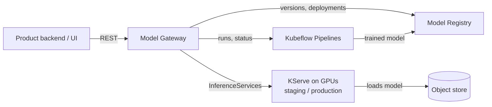

# MLOps Model Gateway

One API that sits between the product and the whole ML platform. The backend says
*"train this"*, *"which versions do we have?"*, *"put v4 in production"*, and the gateway
makes it happen across Kubeflow Pipelines, the Model Registry and KServe.

I designed and built it, and it has been running in production as the single entry point for every
model in the software suite: training runs, versioning and GPU serving for 15+ model types across
vision, speech and NLP. It has been very stable. The backend team builds on it without ever touching Kubernetes.

> The production code is proprietary. This repo explains how it works and why it's built this way.
> All names and endpoints are placeholders.

## How it fits

## What it does

- **Train:** start a pipeline by name. Parameters are checked against the compiled pipeline spec *before*
  anything hits the cluster, so a bad request gets a clear `400` instead of a failed pod ten minutes later.
- **Watch:** live, component-level progress (`current_components`, `failed_components`) even for parallel
  steps and runs that die early. Under the hood it falls back from KFP to the raw Argo workflow.
- **Version:** list model versions with their metrics, lineage and artifacts.
- **Deploy:** one call turns a registered version into a KServe `InferenceService` in staging or production,
  with the right runtime (Triton, vLLM, custom), GPU memory budget and scheduler queue, and records the
  deployment back in the registry.
- **Undeploy / promote:** the same call with a different environment.

Everything cluster-specific lives in a ConfigMap. Adding a new model type is one JSON entry, and moving to a
new cluster means a different ConfigMap with the same image.

## The idea that made it work

One key, **`task_type`**, means the same thing everywhere: the pipeline name, the experiment, the registered model,
the serving config. The backend never sees a Kubeflow UUID. Pipelines get re-uploaded and clusters get rebuilt, and the
API contract stays the same.

## Stack

FastAPI · Kubeflow Pipelines v2 SDK · Kubeflow Model Registry · KServe SDK · Triton · vLLM ·
GPU-queue scheduling with fractional GPU memory · MinIO · Docker · Kubernetes

## More

- [Architecture](docs/architecture.md): modules, config model, environments, request flows
- [API overview](docs/api-overview.md): endpoints with example payloads
- [Design decisions & lessons](docs/design-decisions.md): trade-offs and what I'd do next
- [Examples](examples/): config and a generated InferenceService
