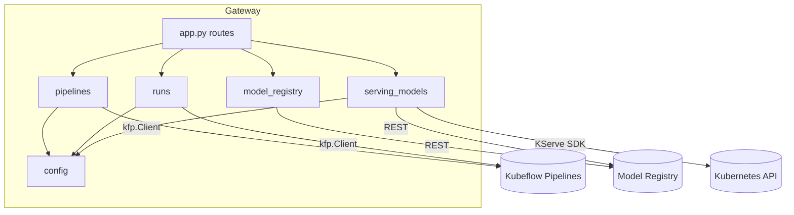
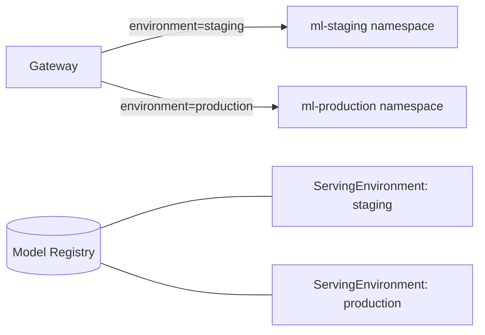
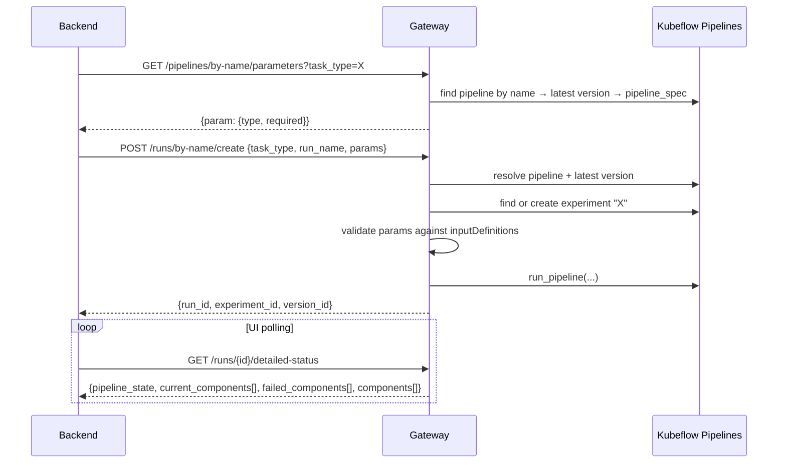

# Architecture

## Component layout

The service is a single FastAPI app split into small modules, one per external system it talks to.

```text
app.py                     FastAPI routes, request/response models
components/
  config.py                env → namespace mapping, task_type → runtime config (from ConfigMap)
  pipelines.py             Kubeflow Pipelines: look up pipelines, read parameter schemas
  runs.py                  Kubeflow Pipelines: create/terminate runs, run + component status
  model_registry.py        Model Registry: versions, version details
  serving_models.py        KServe: build/deploy/delete InferenceServices; registry deployment records
  embeddings.py            specialised run type for embedding pipelines (add/delete operations)
scripts/
  undeploy_all_staging.*   maintenance: clear a staging namespace
k8s/                       ServingRuntimes, ServiceAccount, ConfigMap/Secret templates
Dockerfile                 multi-stage build
```



Every module turns failures into `HTTPException`s with meaningful status codes (`400` bad input,
`404` unknown pipeline, model or version, `503` dependency unavailable, `504` readiness timeout). The
backend can then tell a user error apart from a platform error.

---

## The `task_type` contract

`task_type` is the one identifier shared across the platform:

| System | Meaning of `task_type` |
|---|---|
| Kubeflow Pipelines | pipeline display name **and** experiment name |
| Model Registry | `RegisteredModel` name |
| Gateway config | key into the runtime configuration |
| KServe | source of the InferenceService name (`<task-type>-<suffix>`) |

The backend never deals with UUIDs from Kubeflow or the registry. The gateway resolves them on each call.

---

## Configuration model

All cluster-specific values are injected through a ConfigMap mounted as environment variables.

```bash
# Service endpoints
MODEL_REGISTRY_ENDPOINT=http://model-registry.<ns>.svc.cluster.local:8080

# Environment → namespace
STAGING_NAMESPACE=ml-staging
PRODUCTION_NAMESPACE=ml-production
KUBEFLOW_NAMESPACE=ml-pipelines

# task_type → serving configuration
TASK_TYPE_CONFIGS='{
  "object-detection": {"runtime": "triton-onnx",   "model_format": "onnx",    "service_account": "kserve-sa", "gpu_memory": 5000},
  "speech-to-text":   {"runtime": "vllm-whisper",  "model_format": "whisper", "service_account": "kserve-sa", "gpu_memory": 20000},
  "scene-captioning": {"runtime": "vlm-custom",    "model_format": "vlm",     "service_account": "kserve-sa", "gpu_memory": 8000}
}'
```

So:

- **New model type:** add one JSON entry (plus a ServingRuntime manifest if it needs a new runtime).
- **New cluster:** apply a different ConfigMap. The same image works everywhere.
- **GPU tuning:** change `gpu_memory` and redeploy the model. No rebuild needed.

---

## Environments



Each environment is two things:

1. A **Kubernetes namespace** where the InferenceService runs.
2. A **ServingEnvironment** record in the Model Registry, which tracks which model version is deployed where.

Deploying to staging and promoting to production is the same call with a different `environment` value.

---

## Training run flow



### Component-level status

KFP v2 does not report task details the same way in every situation. For example, a run that failed
early may have no task list at all. The detailed-status endpoint tries three sources in order:

1. The KFP runtime execution summary
2. KFP v2 `run_details.task_details`
3. The underlying **Argo Workflow** object, read directly from the Kubernetes API

All three are normalized into one response shape, so the UI always gets the
`current_components` / `failed_components` lists, even for parallel steps and early failures.

---

## Deployment flow (detail)

1. Validate `environment` and map it to a namespace.
2. Load the runtime config for the `task_type` (runtime, model format, service account, GPU budget).
3. Resolve the `RegisteredModel`, then its versions, then the requested version (or the latest one).
4. Find the **model store URI**. Different model families publish artifacts differently (a Triton model
   repository, a quantized checkpoint, a plain S3 prefix), so the gateway reads a task-specific custom
   property on the model version. If that property is missing, it derives the URI from the artifact.
5. Build a `V1beta1InferenceService` with:
   - `predictor.model.runtime`, `model_format`, `storage_uri`
   - `predictor.schedulerName` set to the GPU queue scheduler
   - a queue label (`inference`) and a `gpu-memory` annotation from config
6. Create or replace the InferenceService through the KServe SDK.
7. Upsert an `InferenceService` record in the Model Registry with `desiredState=DEPLOYED`, so the
   registry knows which version runs where.

Undeploy deletes the KServe resource and sets the registry record to `UNDEPLOYED`. The record is kept
for history.

---

## Deployment of the gateway itself

- Multi-stage Docker build: dependencies are compiled in a builder stage, and only installed packages plus app code go into
  the slim runtime image. A `HEALTHCHECK` hits `/`.
- Runs as a Kubernetes Deployment with a ServiceAccount allowed to manage InferenceServices in the
  serving namespaces and to call the Pipelines API.
- Configuration comes from a ConfigMap, credentials from Secrets. The image contains nothing cluster-specific.
